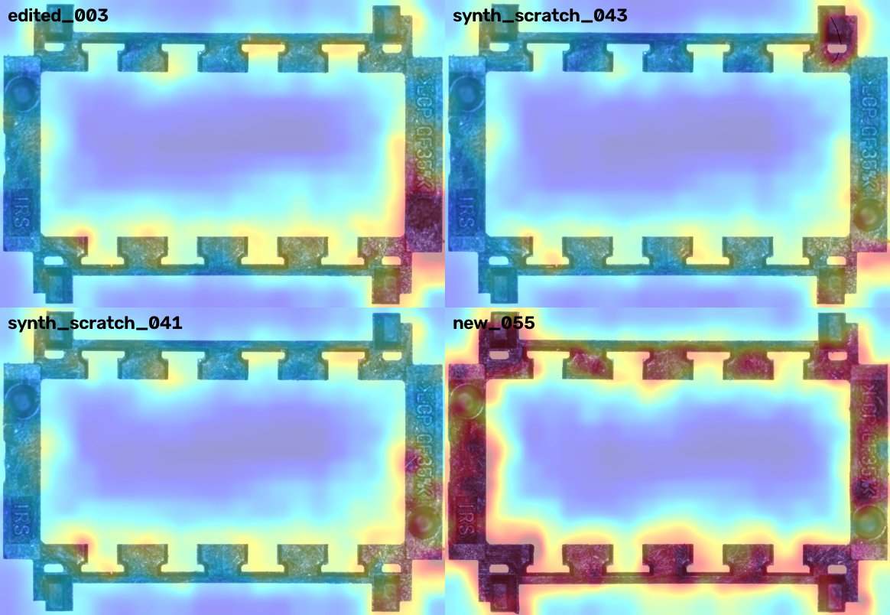

# Anomaly detection for moulded plastic parts on a low-power line PC

Unsupervised visual inspection of an injection-moulded plastic frame (DATN, HUST). The camera photographs every
part on the conveyor, and a small PC next to the line has to decide **OK / NG** and show where the defect is.
Defects are rare and varied, so the models learn only from good parts (anomaly detection: PaDiM, PatchCore).
Models are exported to OpenVINO and measured **on the CPU with 2 threads**, as a proxy for an industrial PC.

The repository contains:

- `partinspect-audit` checks the data for leakage and counts how many physical parts it actually contains.
- `partinspect-split` builds a leak-free split with synthetic defects that have exact masks.
- `partinspect-run` trains each model, exports it (FP32 / FP16 / INT8) and evaluates **the exported file**.
- `partinspect-report` and `partinspect-calibrate` produce the comparisons and the thresholds.
- `partinspect-serve` is a prototype inspection station: folder watch → OK/NG signal, CSV log, heat maps of
  rejected parts, drift alarm.



*Heat maps saved by the station for rejected parts (PaDiM-R18 FP16, 256×368). Top row: a photoshopped NG with the
round mark removed, and a synthetic scratch. Bottom row: a faint synthetic scratch, and a **good** part of a
physical part the model has never seen (part C). That good part is rejected; see "What the data allows".*

> **Read this before quoting any number.**
>
> - The original dataset was leaky. 55 of the 60 test "good" images are byte copies of training images, and all
>   60 NG images are training photos with the defect painted in. The old AUROC of 0.998–1.0 is therefore invalid.
> - The 361 good photos show only **3 physical parts**. Because of that, the rate at which *new* good parts would
>   be rejected cannot be estimated from this data.
> - All numbers below come from the cleaned split. Recall and FPR hold only for parts the model has already seen.

## Results at a glance

PaDiM-R18 FP16, 256×368, OpenVINO, 2 CPU threads, test split (65 good, 180 NG):

| | Value |
|---|---|
| Image AUROC (all test NG vs all test good) | **0.906** (AP 0.963) |
| Image AUROC vs good photos of a seen part (A) | 0.942 |
| Image AUROC vs good photos of an **unseen** part (C, 5 photos) | 0.476, i.e. chance level |
| Recall / FPR at the `good_3sd` threshold | 0.86 / 0.14 (all 5 photos of part C rejected) |
| Large defects (edge chip, missing mark, burn, edited) | 100% caught |
| Small defects (scratch / spot) | 50% / 40% caught |
| Pixel AUROC / AUPRO | 0.995 / 0.958 |
| Latency p50 / p95, 2 threads (Colab Xeon) | 67 / 69 ms per part (~15 parts/s) |
| Model size | 125 MB |

**Recommendation for the line PC:** PaDiM-R18, FP16, 256×368. Switch to 512×736 if the line allows ~240 ms per
part: it separates small defects better (AUROC 0.932) and needs a 481 MB model. Before trusting either one,
recalibrate on 20–50 *different* good parts (see "Recalibration").

## Install

```bash
pip install -e ".[train,export,dev]"   # training + export + notebook (Python >= 3.10, anomalib 2.x, a GPU helps)
pip install -e ".[deploy]"             # line PC: openvino + opencv only, no torch
```

Tested with anomalib 2.7.0, torch 2.15, OpenVINO 2026.4.1, NNCF 3.4.0 on Colab (L4), Python 3.13.
On Colab, install into a virtualenv and set `MPLBACKEND=Agg`, otherwise the matplotlib backend of Colab breaks
the import of anomalib.

## Quick start

On the line PC, with an exported model and a config file:

```bash
partinspect-serve deploy/line_example.json --watch /path/camera_output --out runs/line1
#   001_part.png: OK score 58.4 (71 ms)
#   021_part.png: NG score 83.4 (70 ms)        -> runs/line1/ng/021_part_ng.jpg
#   ALARM: NG rate 24% over the last 50 parts          (printed and logged when an alarm fires)
```

To reproduce everything from the raw data (the GPU steps took about 1–2 hours on an L4):

```bash
partinspect-audit  data/MyDataset --json reports/audit.json        # leakage + physical-part check
partinspect-split  data/MyDataset --out data/prepared              # clean split + synthetic defects
partinspect-run    padim_r18 padim_r18_d50 patchcore_r18 --precisions fp32 fp16 int8 int8_ptq --out results
partinspect-run    padim_r18 padim_r18_d50 --image-size 512 736 --precisions fp32 fp16 int8 int8_ptq --out results
partinspect-report results --policy good_3sd --md reports/zoo_v2_good_3sd.md
partinspect-calibrate padim_r18 --out results_cal                  # blocked k-fold thresholds (section 5)
```

The notebook [notebooks/DATN_AnomalyDetection.ipynb](notebooks/DATN_AnomalyDetection.ipynb) (Vietnamese) walks
through all steps with figures. By default it only reads `results/`, so it runs without a GPU
(`RUN_TRAINING=1` retrains everything).

## 1. Data audit

The data is the folder `HUST/DATN/MyDataset` on Drive, in MVTec layout: `train/good` (301), `test/good` (60),
`test/NG` (60) and `ground_truth/NG` masks. The photos are 1163×803 px. `partinspect-audit` runs three checks:

1. **Exact duplicates** across splits (MD5).
2. **Edited copies.** For each NG image, find the closest training image *outside the defect mask*. Two separate
   photos of the same part differ by about 1/255 (sensor noise). An NG image that matches a training photo to
   0.06/255 outside its mask is that photo with the defect painted in.
3. **Physical parts.** Every moulded part has its own fine surface texture: flow marks, tiny scratches. The check
   high-pass filters a plain plastic patch (after aligning the photos) and correlates the result between photos:

   | Pair | Texture correlation |
   |---|---|
   | Same part, different photos | 0.89–0.99 |
   | Different parts | 0.07–0.21 |
   | Two different patches of the same photo (control) | 0.02 |

   Photos are grouped greedily at a correlation of 0.5.

Findings on `MyDataset`:

| Finding | Consequence |
|---|---|
| `test/good/000–054` are byte copies of `train/good/000–054` | the old test set was partly the training set |
| 60/60 `test/NG/i` = `train/good/i` with a Photoshop edit: round mark removed (000–029) or engraved text removed (030–059) | the defects are not real, and their source photos were in training |
| The good photos show only 3 physical parts: **A** = `train/good/000–092, 094` (+ the test copies), **B** = `093, 095–300`, **C** = `test/good/055–059` | the variation between good parts is almost never observed (section 5) |
| `MyDataset_old` is the same data, except that `test/good/055–059` are copies as well | redundant, moved to the Drive trash |

The photos also get gradually darker along the capture order: the part's grey level goes from 84 to 80 (78 for
part C). `partinspect-normalize` corrects this, but the correction changed nothing in the results (section 5).

## 2. Split and synthetic defects

`partinspect-split` (seed 0) writes symlinks plus generated images to `data/prepared/`, with a `manifest.csv` that
has one row per image (split, label, defect type, source, mask):

| Split | Good | NG | Notes |
|---|---|---|---|
| train | 201: `train/good/065–265` (parts A, B) | – | |
| val | 30: `271–300` (part B) | 30 synthetic (5 per type) | used only to choose thresholds |
| test | 65: `000–059` (part A, the sources of the edited NG) + `055–059` (part C) | 60 edited + 120 synthetic (20 per type) | |

- The photos are numbered in capture order, and neighbouring shots are near-duplicates. For that reason the
  blocks are **contiguous, with a gap of 5 photos** between them.
- A first version drew val at random. Every val photo then had its two neighbours in training. Val scores came out
  too low, and at 512×736 the threshold chosen on them rejected 74–88% of the good test parts. The old reports are
  kept as `reports/zoo_v1_randomval_*`.

Synthetic defects (`synth.py`) change pixels **only inside the mask they return** (unit-tested), so every mask is
an exact label. The positions of the mark and the text are those of this part. The six types:

| Type | What it does |
|---|---|
| `missing_mark` | the right round mark is filled with real plastic texture, taken from a plain stretch of the left bar |
| `erased_text` | part of the engraved text is filled the same way |
| `scratch` | a thin bright or dark polyline, 2–4 px |
| `spot` | 1–3 dark dots, 4–10 px |
| `edge_chip` | a polygon at the part edge (radius 18–40 px) replaced by background |
| `burn` | a darker, brownish ellipse |

The defects cover 0.5–2% of the image. At 256×368, a scratch is 1 px wide.

## 3. Models, export and measurement

| Name | Method | Backbone / setting |
|---|---|---|
| `padim_r18` | PaDiM: a Gaussian per position on CNN features, Mahalanobis distance | ResNet-18, all 448 feature channels |
| `padim_r18_d50` | PaDiM | ResNet-18, 50 random channels (smaller covariance) |
| `patchcore_r18` | PatchCore: nearest neighbour in a memory bank of patch features | ResNet-18, coreset 10% |
| `patchcore_wr50`, `patchcore_wr50_c01` | PatchCore | Wide-ResNet-50, coreset 10% / 1% (v1 split only) |
| `efficientad_s` | EfficientAD-S (student–teacher) | not evaluated: the ImageNette download failed (HTTP 504) |

`partinspect-run` handles each model in turn:

1. Fit on `train/good` with `seed_everything(0)`. PaDiM picks its channels at random: unseeded runs scattered
   AUROC between 0.89 and 0.93, so differences below ~0.03 are noise.
2. Export to OpenVINO at each precision, and evaluate the exported file on val and test:

   | Precision | What it is |
   |---|---|
   | `fp32` | full precision |
   | `fp16` | weights in FP16 |
   | `int8` | NNCF weight compression; activations stay FP32 |
   | `int8_ptq` | NNCF post-training quantisation of the whole graph (weights + activations), calibrated on val |

3. Choose thresholds on val only, then apply them unchanged to test. The policies are in `metrics.thresholds_from_val`:

   | Policy | Threshold | Remark |
   |---|---|---|
   | `good_3sd` | mean + 3 std of the good val scores | default |
   | `good_max` | just above the highest good val score | |
   | `f1` | best F1 on val | depends on the NG share of val (50% here, far from a real line), so it sits too low |
   | `recall_100` | lowest NG val score | |

   `good_3sd` and `good_max` need **only good parts**, so they can be set up on a line before any defect has been
   collected.
4. Compute the metrics:
   - image AUROC and AP;
   - recall and FPR at each threshold, and recall per defect type;
   - pixel AUROC and AUPRO (per-region overlap up to FPR 0.3, as in the MVTec AD benchmark).
5. Measure latency on 60 test images (5 warm-up) with OpenVINO limited to 2 threads (`INFERENCE_NUM_THREADS=2`,
   latency hint), and again with all threads. The clock runs from the decoded RGB frame to the score plus the
   anomaly map; resize and normalisation are inside the model.

## 4. Results

Hardware: Colab, Intel Xeon CPU limited to 2 threads (a *proxy*; measure on the real PC with `partinspect-serve`).
Split v2. Thresholds use the `good_3sd` policy. All rows are FP16.

| Model | AUROC | AP | Recall | FPR | Scratch | Spot | Edge chip | Missing mark | Burn | Pixel AUROC | AUPRO | MB | p50 ms (2 thr) | p50 ms (12 thr) |
|---|---|---|---|---|---|---|---|---|---|---|---|---|---|---|
| **padim_r18** | **0.906** | 0.963 | 0.86 | 0.14 | 0.50 | 0.40 | 1.00 | 1.00 | 1.00 | 0.995 | 0.958 | 125 | **68** | 29 |
| padim_r18_d50 | 0.884 | 0.941 | 0.67 | 0.08 | 0.25 | 0.30 | 0.90 | 0.20 | 0.85 | 0.993 | 0.949 | **36** | 57 | 26 |
| patchcore_r18 | 0.880 | 0.955 | 0.54 | 0.03 | 0.10 | 0.15 | 0.75 | 1.00 | 0.20 | 0.994 | 0.914 | 28 | 377 | 134 |
| padim_r18 512×736 | **0.932** | 0.967 | 0.14* | 0.00* | 0.10 | 0.15 | 0.80 | 0.00 | 0.20 | 0.999 | 0.990 | 481 | 243 | 129 |
| padim_r18_d50 512×736 | 0.919 | 0.956 | 0.14* | 0.00* | 0.15 | 0.10 | 0.75 | 0.00 | 0.15 | 0.999 | 0.989 | 126 | 202 | 87 |
| patchcore_wr50 (v1 split) | 0.686 | 0.849 | – | – | | | | | | 0.991 | 0.872 | 150 | 974 | |
| patchcore_wr50 coreset 1% (v1) | 0.700 | 0.867 | – | – | | | | | | 0.990 | 0.872 | 60 | 248 | |

\* At 512×736 the val threshold sits far above the test scores, so it is unusable; see section 5. AUROC does not
depend on the threshold and stays valid. Full tables per defect type and for both policies:
[reports/zoo_v2_good_3sd.md](reports/zoo_v2_good_3sd.md) and [reports/zoo_v2_good_max.md](reports/zoo_v2_good_max.md).

### Precision (compression)

| Model | Precision | AUROC | MB | p50 ms (2 thr) |
|---|---|---|---|---|
| padim_r18 | fp32 | 0.906 | 249 | 67 |
| | **fp16** | 0.906 | 125 | 68 |
| | int8 (weights) | 0.913 | 66 | 67 |
| | int8_ptq | 0.869 | 67 | **52** |
| padim_r18 512×736 | fp16 | 0.932 | 481 | 243 |
| | int8_ptq | 0.942 | 257 | **168** |
| patchcore_r18 | fp16 | 0.880 | 28 | 377 |
| | int8_ptq | 0.848 | 60 | 370 |

- **FP16 is free.** It gives the same scores as FP32, to the third decimal, at half the size. It is the default.
- **INT8 weight compression** keeps accuracy and cuts the size to a quarter, but it is **not faster**: the weights
  are decompressed to FP32 before computing. Use it when disk or RAM is short, not when time is short.
- **INT8 PTQ:**
  - It is 20–30% faster for PaDiM. At 256×368 AUROC drops by 0.04, and the score scale moves, so the threshold has
    to be chosen again on the quantised model.
  - For PatchCore it brings nothing: the time goes into the nearest-neighbour search, which is not quantised.
  - Keeping PaDiM's Mahalanobis MatMul in FP32 (`int8_cnn` in `experiment.py`) scored worse (AUROC 0.80), so it
    was dropped.

### What the data allows: seen part vs unseen part

| Model | AUROC NG vs good of part A (seen in training) | AUROC NG vs good of part C (never seen, 5 photos) | Part C rejected at `good_3sd` |
|---|---|---|---|
| padim_r18 | 0.942 | 0.476 | 5/5 |
| padim_r18_d50 | 0.941 | 0.202 | 5/5 |
| patchcore_r18 | 0.908 | 0.542 | 2/5 |
| padim_r18 512×736 | 0.977 | 0.387 | 0/5 (threshold too high) |

To the models, a good part they have never seen looks as abnormal as a defective part. With 3 physical parts,
part-to-part variation is simply not in the training data. The good-vs-NG numbers above measure "is this one of
the parts I memorised", not "is this a good part". Five photos are too few for a precise estimate, but the
direction is clear.

## 5. Thresholds: three attempts, and why none is reliable here

| Attempt | Result (PaDiM-R18) | Cause |
|---|---|---|
| val = 20 random good photos | 512×736: FPR 0.74–0.88 on test | val photos had their near-duplicate neighbours in training |
| val = contiguous block 271–300 | 256: recall 0.86 / FPR 0.14 (3σ), 0.97 / 0.72 (max); 512: recall 0.14 | val is part B, while test good is mostly part A (and C) |
| blocked 5-fold (`partinspect-calibrate`), threshold = p99 of out-of-fold good scores | recall 0.36, FPR 0.015 | the fold holding out the end of part A (065–094) scores ~79 when the model has learnt mostly part B, which pushes the threshold up |

`partinspect-calibrate` does the following:

1. Split all non-test good photos into 5 contiguous blocks.
2. For each block, fit on the other blocks, minus 5 photos at each border.
3. Export in the deployed precision and score the held-out block. This gives one unseen-part score per good photo.
4. Set the thresholds from these scores (p99, p99.5, max).
5. Fit the final model on everything and test it.

This is the right procedure, and it is ready for a dataset with many parts. On this dataset it can only show
that held-out parts score like defects. Brightness normalisation (`partinspect-normalize`) left the k-fold result
unchanged, so lighting is not the cause.

## 6. Inspection station prototype

```
camera ──image──▶ incoming/ ──▶ partinspect-serve ──▶ PASS / REJECT  (stub: replace with digital output / PLC write)
                                      │
                                      ├─▶ inspections.csv   time, file, score, OK/NG, latency, alarms
                                      ├─▶ ng/<part>_ng.jpg  heat map of each rejected part
                                      └─▶ drift alarm       median score of OK parts moved > 3 reference std,
                                                            or NG rate of the last 50 parts > 20%
```

- **Software on the line PC:** `openvino` and `opencv` only. The model file contains resize, normalisation,
  backbone and scoring.
- **Config:** [deploy/line_example.json](deploy/line_example.json) holds the model, threshold, threads and the
  drift reference (median and std of the good scores used for the threshold).
- **Input:** a file is processed once its size stops changing, so a half-written image is never read.
- **Demo run** (Colab, 2 threads; log in `docs/station_demo_inspections.csv`):

  | Images | Result |
  |---|---|
  | 20 good photos of part A | 19 OK |
  | 5 good photos of part C | 5 NG |
  | 5 edited NG | 5 NG |
  | 5 synthetic scratches | 2 NG |

  Latency was 70–72 ms per part.
- **Same model, different CPU, different scores.** On an Apple-silicon Mac (ARM) the same FP16 model scores about
  1 point differently from the Colab Xeon (x86). `orig_003`, for example, scores 65.2 (OK) on the Mac and 65.9 (NG)
  on Colab, against a threshold of 65.2. Calibrate the threshold on the line PC itself.
- **Drift monitor:** the notebook replays 100 parts of A followed by part C. The NG-rate alarm fires at part 109,
  9 parts after the switch, which is the cue to stop and recalibrate.

### Recalibration (what to do on a real line)

1. Photograph 20–50 **different** good parts, 2–3 shots each, under the line's lighting.
2. Run `partinspect-audit` on them. The physical-part check confirms they really are different parts.
3. Run `partinspect-calibrate`: the blocks become groups of parts, and the thresholds come from out-of-fold scores.
4. Put the threshold and the drift reference into the config. Repeat after any change of lighting, camera,
   material batch or mould.

## Repository layout

```
src/partinspect/
  audit.py       leakage + physical-part checks                  partinspect-audit
  split.py       leak-free split, synthetic defects, manifest     partinspect-split
  synth.py       6 synthetic defect generators with exact masks
  experiment.py  model zoo: fit, export, evaluate, latency        partinspect-run
  metrics.py     image / pixel metrics, threshold policies
  report.py      tables from saved scores                         partinspect-report
  calibrate.py   blocked k-fold thresholds                        partinspect-calibrate
  normalize.py   photometric normalisation                        partinspect-normalize
  deploy.py      inspection station prototype                     partinspect-serve
tests/           17 unit tests (synthetic defects only touch the mask, metrics, physical-part grouping, station, drift)
notebooks/       DATN_AnomalyDetection.py (source, percent format) and .ipynb (executed)
results/         per model: results.json + scores_<precision>.csv (exported models not kept: retrain with partinspect-run)
results_cal/     k-fold calibration outputs
reports/         audit.json, zoo tables (v2 = current split, v1_randomval = first split)
deploy/          line_example.json
models/          padim_r18_256x368_fp16 (OpenVINO IR used by the station; on Drive, not in git)
docs/            figures and the station demo log
```

## Engineering notes (problems met and fixed)

- **PatchCore export kept batch = 2.** `torch.export` specialised the dynamic batch axis to the size-2 example
  input, so the model refused single images. Export now uses `dynamic_axes={"input": {2: "height", 3: "width"}}`
  with batch fixed to 1.
- **anomalib's `INT8_PTQ` failed with a dynamic input shape.** It reads `input.shape`. `experiment.quantize`
  calls NNCF directly.
- **The process died with SIGBUS during quantisation.** OpenVINO memory-maps `model.bin`, and writing the quantised
  model over it killed the process. The model is now saved to a temporary file and renamed.
- **Colab's inline matplotlib backend broke anomalib.** The import of anomalib (through torchmetrics) failed;
  setting `MPLBACKEND=Agg` fixes it.
- **`Engine(enable_checkpointing=False)` fails.** It conflicts with anomalib's own ModelCheckpoint callback, so
  the argument is left out.

## Limitations and next steps

1. **Data.** Collect 20–50 different good parts and real defective parts. This is the only way to get a
   false-reject rate that means anything.
2. **Public benchmark.** Evaluate on VisA (CC BY 4.0, real defects, hundreds of parts) or MVTec AD for numbers
   that can be compared with the literature.
3. **Small defects.** Tile the full-resolution image instead of scaling the whole image up: 512×736 already costs
   ~240 ms.
4. **Missing model.** Retry EfficientAD-S. It is fast on CPU, but it needs ImageNette for its penalty loss.
5. **Hardware.** Measure on the real line PC.

## Licence

Code: Apache-2.0. The dataset is the author's own photos and is not distributed with the code
(Drive `HUST/DATN/MyDataset`). PaDiM, PatchCore and EfficientAD come from
[anomalib](https://github.com/open-edge-platform/anomalib) (Apache-2.0); ImageNet-pretrained backbones are from
torchvision.
